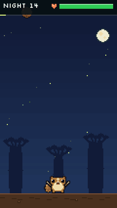
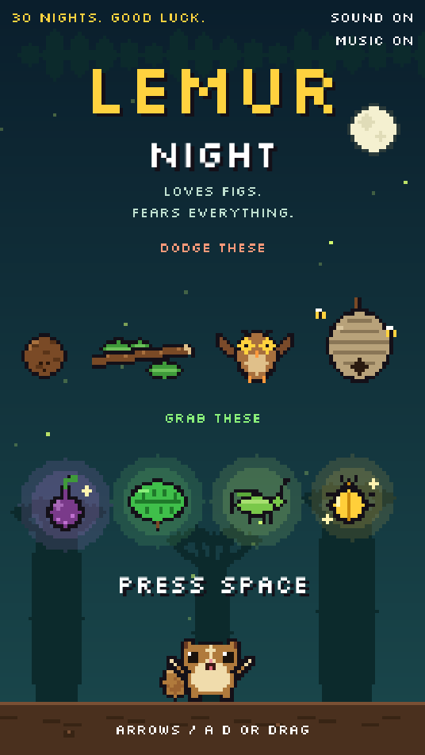
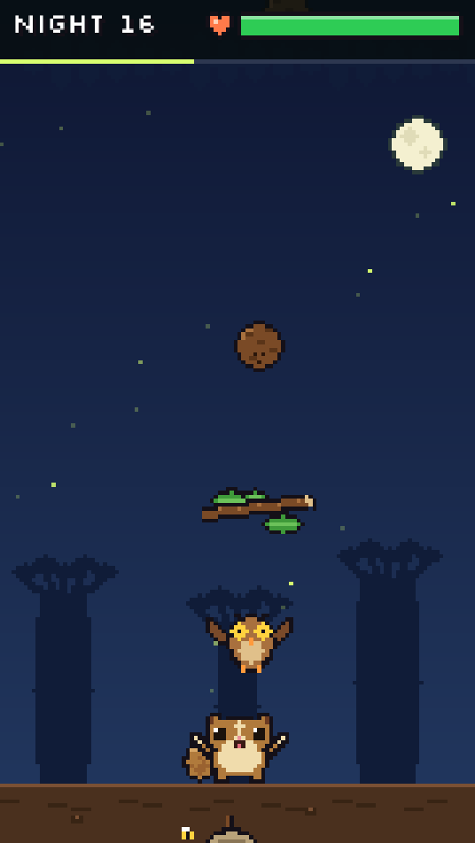
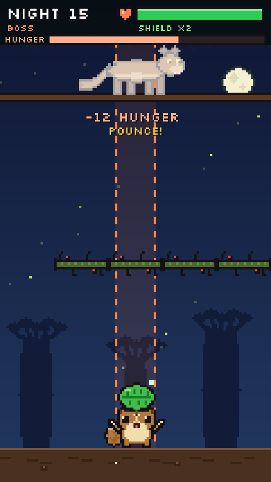

# Lemur Night

A tiny pixel-art survival game for the browser. You're a mouse lemur in a Madagascar forest, and everything is falling on you. Survive 30 nights.

<p align="center">
  
</p>

**[▶ Play it here](https://0pandc0.github.io/lemur-night/)**: works on phone and desktop, no install.

| Title | A busy night | Night 15: the fossa |
|---|---|---|
|  |  |  |

## The game

- **30 nights**, each harder than the last. The last 3 seconds of every night are a calm dawn.
- **Dangers**: coconuts, snapped branches, tree boas, hornet nests, zig-zagging owls and grumpy chameleons.
- **Storm nights** (every 5th night, and the final night) bring rain, faster drops and more of them.
- **Power-ups**: a ripe fig (slow motion), a leaf shield (blocks 2 hits), a crunchy cricket (+30 HP) and a rare golden beetle (one extra life).
- **Night 15 boss: the fossa**, Madagascar's real lemur predator. It prowls the branch above you, shakes down seed pods, drops thorny branches with one gap, sends wasps and pounces down a marked column. Survive until it gives up.
- A victory dance after every night, a best score saved on your device, and a rank when you're done.

**Controls:** arrow keys / A D, or drag anywhere on touch screens · Space to start/skip · P pause · M sound · N music

## How it's built

Plain JavaScript (ES modules) and a single `<canvas>`. No framework, no build step, no image or audio files.

- **All art is code.** Every sprite is a string map or a few shape calls in [`src/sprites.js`](src/sprites.js), drawn once into offscreen canvases at startup. The 120×213 canvas is integer-scaled to the screen at device pixel ratio, so pixels stay crisp on every display.
- **All sound is code.** Effects and four chiptune tracks (calm, storm, boss, boss rage) are synthesized live with the Web Audio API by a small look-ahead step sequencer in [`src/audio.js`](src/audio.js).
- **Hard, but never impossible.** [`src/fairness.js`](src/fairness.js) checks every new danger before it spawns:
  1. whatever crosses the lemur's row at the same time must leave a gap at least 20 px wide, and
  2. a reachability search steps the next few seconds forward (1/30 s at a time, at the lemur's real speed, slow-motion aware) and only allows the spawn if some path still dodges everything.

  Nothing spawns too late to clear the lemur before dawn, and standing still too long makes some spawns aim at you, so there's no safe corner to camp in.
- **All tuning in one place.** Night length, speeds, spawn rates and damage curves live in `TUNE` in [`src/config.js`](src/config.js).

```
index.html, style.css
src/
  main.js       canvas sizing, main loop, test hooks (#dev only)
  state.js      the single shared game state
  config.js     constants + difficulty tuning
  content.js    dangers, power-ups, all on-screen text
  world.js      night flow, spawning, collisions, update
  boss.js       the fossa fight
  fairness.js   gap rule + reachability search
  render.js     everything drawn on screen
  sprites.js    pixel art generated in code
  pixel.js      tiny drawing toolkit
  audio.js      synthesized SFX + music sequencer
  input.js      keyboard, mouse, touch
tools/          automated QA (Playwright)
```

## Run it locally

ES modules need a local web server (opening the file directly won't work):

```bash
python3 -m http.server 8765
# open http://localhost:8765
```

## Testing

The game is tested by scripts that drive it through hidden test hooks (only active with `#dev` in the URL):

```bash
pip install playwright
python3 -m http.server 8765 &
cd tools
python3 qa.py        # 20 checks: fairness every night, power-ups, boss, mechanics, text fit, real input, errors
python3 oracle.py    # a path-planning bot plays full runs to prove all 30 nights are beatable
python3 deadzone.py  # no spot on the branch is much safer than the rest; camping gets punished
python3 perf.py      # frame time on a phone-sized screen in the busiest scenes
```

Latest results: 20/20 QA checks passed, 0 frames with an impossible wall across 90 simulated nights, every power-up reachable, nothing left falling at dawn, the bot won 3/3 full runs with 0 hits, no spot on the branch is a safe camping corner, and p99 frame time is under 8 ms on a phone-sized canvas.

## Credits

Made by **P&C** ([@0PandC0](https://github.com/0PandC0)).
Font: [Silkscreen](https://github.com/googlefonts/silkscreen) by Jason Kottke, SIL Open Font License ([`assets/fonts/OFL.txt`](assets/fonts/OFL.txt)).

## License

Code and art © 2026 P&C (0PandC0). All rights reserved: you're welcome to play it, read the code and learn from it, but please don't republish it as your own.
